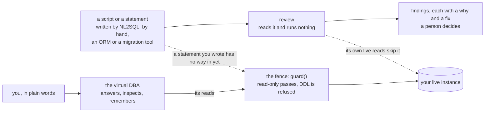

# schemafence

[](https://github.com/empoGavin/schemafence/actions/workflows/qa.yml)
[](.github/workflows/qa.yml)
[](LICENSE)
[](requirements.txt)

> Statements are increasingly written by NL2SQL, and every one of them — however it was written —
> arrives at the same place: the database, the node the whole application leans on. So the database
> gets a fence in front of it. A script or a statement is reviewed before anything is done with it,
> and one gate decides whether a statement may run at all.
>
> Reviewing scripts is standing work for a DBA: it arrives in volume, and what counts as a problem
> differs from one shop to the next. So the checks have to be addable without a release — and being
> able to add a rule by describing it in plain words is what makes that worth having.
>
> A DBA carries a shelf of databases and not enough time for each of them. So give each one a
> virtual DBA: an agent you talk to in plain words, that inspects that instance on a schedule,
> diagnoses what it finds, and follows the habits that one instance has. The more instances you
> carry, the more it pays off.
>
> Four things a DBA has on their desk: a script to review, a query somebody says is returning the
> wrong number, a question you would otherwise go to the runbook for, and a live instance to
> diagnose.
>
> Hand it a script or a statement and it lists what will go wrong before anything runs: a table
> dropped, a `NOT NULL` column added with no default, a measure summed after a one-to-many join, a
> `LEFT JOIN` cancelled by a `WHERE`. Ask the question and it answers from your own runbook,
> quoting the note it read. Point it at a live instance and it reads what is there now and keeps
> what it saw — so it is the agent that knows *this* instance rather than instances in general.
>
> The reads the agent makes of a live database go through one fence first: read-only statements pass,
> DDL is refused, and no model decides whether a statement may run. What does not reach it yet is
> named in [What it will do to your database](#what-it-will-do-to-your-database-and-what-it-will-not).
>
**Contents** — [Quick start](#quick-start) ·
[What it will do to your database, and what it will not](#what-it-will-do-to-your-database-and-what-it-will-not) ·
[Ask a question, or run a diagnosis](#ask-a-question-or-run-a-diagnosis) ·
[Review a script, or a query](#review-a-script-or-a-query) · [Environment](#environment) ·
[Status](#status) · [Known limitations](#known-limitations) · [FAQ](#faq) ·
[Why I built this](#why-i-built-this) · [Contributing](#contributing) · [License](#license)

Docs (Chinese): [quickstart](docs/quickstart.md) — offline, then a real database ·
[architecture](docs/architecture.md) — which file does what ·
[corpus](docs/corpus.md) — what to load, and how well it answers ·
[bench](docs/bench.md) — the numbers, and how to reproduce them ·
[roadmap](docs/roadmap.md) — what is built, and what is next ·
[overview](docs/README.md) — the same opening, in Chinese

## Quick start

```bash
git clone https://github.com/empoGavin/schemafence && cd schemafence
python demo.py          # no database, no model, no API key, about 30 seconds
```

```
schemafence — a read-only diagnostic agent, a reviewer, and a fence
====================================================================
source : sample_schema.sql
tables : 7      columns : 33
mode   : offline (no database, no model, no API key)

[check 1] schema resolution — which entity gets picked   (1)
[check 2] join-key sanity — rows silently dropped   (4)
[check 3] type & precision — values silently changed   (6)
[check 4] NULL semantics — three-valued logic traps   (1)
[check H] hygiene — comments and naming   (4)
[summary]
  16 finding(s): 5 high / 9 medium / 2 low
```

Each finding prints a why and a fix; four selftest blocks close the run — 13 guard, 10 router,
7 tools, 12 sql-checks, each ending `N cases → all passed`.

To review a script somebody else wrote, with the rules in the repo and nothing else installed:

```bash
python -m schemafence.review --rules rules/table-hygiene.json \
       --rules rules/change-review.json --script examples/change_script_review.sql
```

## What it will do to your database, and what it will not

The project has three parts: **review** a script or a statement, a **diagnostic agent** that
reads an instance and remembers what it saw, and **the fence** that decides what may run.



Solid is what is wired today. Dotted is the two gaps: both are listed under
[Known limitations](#known-limitations), and work on them is on the [roadmap](docs/roadmap.md).

Read-only is not a setting here, it is the shape of the thing. Every command below obeys three
statements:

- **A review runs nothing.** The reviewer reads a schema, a script, or a query, and prints
  findings. It opens no transaction, so a script full of `DROP` and `ALTER` is a normal input
  rather than something it has to be trusted with.
- **Anything that runs against a live database goes through one gate.** `guard()` is the one
  place a statement is allowed to reach a database: it lets read-only statements through, refuses
  DDL, and writes every call to `agent_trace.jsonl` with the decision, the layer and the
  duration. The agent's tools pass it today; what does not yet is named under
  [Known limitations](#known-limitations).
- **No model decides whether a statement may run.** The checks and the gate are fixed code, and
  retrieved text goes into the answer and no further.

The diagnostic agent answers a question and reads an instance: the same agent, the same stored
notes, both ways of answering. It is the half allowed to be wrong, because a bad answer is bad
advice rather than damaged data. What it has instead of a guarantee is a hit rate per question over
44 of them — [`eval/report-dba.md`](eval/report-dba.md) — answered through
`schemafence/knowledge.py` and `schemafence/agent.py`. Two questions from the eval set — *why is the
orders table slow* and *what does `idle in transaction` cost us* — show what that looks like; storage
numbers under both backends are in [`docs/bench.md`](docs/bench.md).

The reviewer and the fence take different things in, and that is the part worth knowing:

|  | **the reviewer** — reports | **the fence** — decides |
| --- | --- | --- |
| Reads | a schema, a script, or a query plus a schema | the statement that is about to run |
| Input may contain writes | yes — it runs nothing | no — read-only only, DDL refused outright |
| Hands back | findings, each with a why and a fix | allow or block, and the layer that stopped it |
| Changed by | rules are files under `rules/`, and more can be added | thresholds are configuration; the decision logic is not |
| Written in | `checks.py`, `checks_sql.py`, `rules/*.json` | `guard.py` |

So a change script never reaches the gate: `guard()` refuses DDL by construction, the script goes to
the reviewer, the report goes to a person, and the person decides — that is the flow, not a gap in
it. A person, an ORM, a schema tool and a model all write these scripts, and the reviewer does not
care which of them it is.

They are wired together in exactly one place, `Toolbox` in `schemafence/tools.py`: retrieved passages
go into the answer text and no further, so a mediocre retrieval score is a quality problem, not a
safety one. **What reaches that gate is narrower than what it is meant to cover** — the reviewer's
own reads, and no way in for a statement you wrote (there is no `--sql`, no `--file`, and no service
to call) — and both gaps are measured under [Known limitations](#known-limitations).

## Ask a question, or run a diagnosis

`demo.py` audits a schema. `agent_cli.py` answers questions against one, choosing
between the knowledge base and the live catalogue.

```bash
python agent_cli.py --ingest examples/knowledge-dba   # chunk → embed → store
python agent_cli.py --ask "订单表查询走了顺序扫描，是不是该加个索引？"
python agent_cli.py --eval --report eval/report-dba.md # hit rate + tuning grid
```

**Four tools** — `search_docs`, `run_sql`, `explain_sql`, `get_table_stats` — all through
one door, `guard()`, and every call appended to `agent_trace.jsonl` with its decision, its
layer and its duration. The loop is hand-written rather than delegated to a framework, so
tool selection and failure handling stay explainable line by line: a tool that fails is not
called again, a spent failure budget ends the round with a plain-text answer instead of an
empty one, and a model endpoint that goes quiet is retried with backoff while a 4xx is not.

**A keyword is not intent.** `删除` appears in `帮我删掉 orders 这张表`, which has to be
refused, and in `怎么安全地删除大表的历史分区？`, which has to be answered. The router
reads the shape of the sentence as well as the vocabulary: a write request that reaches the
tools is stopped by `guard()` with no side effect, while a real question that gets refused is
simply lost. So the router errs toward answering and the determinism stays in the layer that
can enforce it.

**Three independent axes**, not one "offline vs live" switch:

| axis      | default                             | switched by                       | if you leave it out                        |
| --------- | ----------------------------------- | --------------------------------- | ------------------------------------------ |
| embedding | hashed lexical vector + corpus IDF  | `SF_EMBED_API_KEY`                | nothing is downloaded and no SDK is needed  |
| store     | JSON file under `.schemafence/`      | `--db` → pgvector + HNSW          | stays a file on disk, still works          |
| driver    | rule-based router                   | `--llm openai` + `SF_LLM_API_KEY` | stays deterministic, still answers         |

"Live" here means a real database is attached (`--db`), and it says nothing about API
keys: `--db` with no key is supported and useful, and both quickstarts run that way.

### The corpus, and why retrieval quality is measurable

Five corpora ship with the repo — de-identified runbooks, synthetic DBA notes, an operations
pack, the PostgreSQL 16 manual and *PostgreSQL 14 Internals* — all meant to be replaced with
your own. **Corpus shape decides retrieval quality more than size does:** the hand-written pack
scores 100% top-5 over 50 questions while the full manual scores 82.5% over 40, and merging
them costs the runbook questions 30 points while costing the syntax questions nothing. Sizes,
the measured cost of merging (96.8% → 74.6% over 201 questions, 89.7% at `--k 20`) and the
pgvector ingest shapes are in [`docs/corpus.md`](docs/corpus.md), along with the rules for notes
that cannot leave a company. `--eval`
is a measuring stick, not a gate: 44 questions over 40 chunks come out at **97.7% top-5**
offline, with the relevance floor named rather than guessed.

### Diagnostic runs, and what the agent remembers

The same agent is meant to run a **diagnosis**: walk a set of checks over one instance in a single
pass, print what it looked at and what came back, and say what the findings add up to — each
conclusion traceable to the note, the case, or the procedure it came from. Running it repeatedly is
also what gives the agent a memory of *this* instance: every pass is kept, so a later question can
be answered against what earlier passes saw, and not only against what the catalog holds right now.
That memory is what makes it the agent that knows **this** instance rather than instances in
general.

**There is no diagnostic command yet**, and nothing is kept between runs. What the agent works with
is the live read (`snapshot.py`) and the checks over a schema (`checks.py`); the pass that would tie
them into one conclusion is on the [roadmap](docs/roadmap.md).

## Review a script, or a query

### The failure it is aimed at

NL2SQL has had a few years now, and the hard part turned out to be the database rather than
the language model. The common failure is not a syntax error but a misread schema: the wrong
table, a lossy join key, a nullable column read as plain, two similarly named fields confused.
### What it checks

| # | Check | Catches |
| --- | --- | --- |
| 1 | **Schema resolution** | Near-duplicate tables and columns the model will confuse (`orders` / `orders_archive`) |
| 2 | **Join-key sanity** | Nullable key columns: the join that silently drops rows |
| 3 | **Type & precision mismatch** | Money in floating point, timestamps held as text, timestamps without a zone |
| 4 | **NULL semantics** | `NOT IN (SELECT …)` over a nullable column — returns empty, no error |
| 5 | **Result plausibility** | A result that does not add up — see below |
| S | **SQL-side semantics** *(S1, S3)* | A measure summed after a one-to-many join has multiplied it; a `LEFT JOIN` cancelled by a `WHERE` on the right table |
| 6 | **Runtime guardrails** | Seven layers: L1 single statement · L2 read-only shape · L3 deny-listed keywords · L4 dangerous functions · L5 table whitelist · L6 forced LIMIT · L7 audit + session hardening |

**Check 5** is the odd one: its subject is a **result** rather than a statement, so it needs a live
connection. It looks for a row count far outside what the joins and filters can allow, a breakdown
that does not reconcile with its total, or a column that comes back mostly NULL. The half that
predicts what a result can and cannot look like from a schema and its statistics is not built; the
[roadmap](docs/roadmap.md) carries it.

Checks 1–4, S and the seven layers run with or without a database. The reviewer reads a script in two
passes — the schema it leaves behind, and the actions it takes to get there — and its rules are
files, so adding one does not mean editing the engine. Which rules exist, which checks are still
missing, and what each of them needs is in [`docs/roadmap.md`](docs/roadmap.md).

### Reviewing somebody else's script

A review rule says which facts to look at and what they must hold, and it carries the examples
that prove it. `load_rulepack` runs those examples first and refuses the file if any label is
wrong, which is what makes a rule safe to add without a code change. Write one by hand against
the exported vocabulary, or describe what you want and give two example scripts — that second
route is the next section.

```bash
python -m schemafence.review --vocabulary > vocabulary.json   # the closed vocabulary
python -m schemafence.review --rules rules/table-hygiene.json --verify
python -m schemafence.review --rules rules/table-hygiene.json \
       --rules rules/change-review.json --script examples/change_script_review.sql
```

```
schemafence review — a rule pack, and a script somebody else wrote
======================================================================
rules  : table-hygiene            (5 rules, 14 examples verified)   table-hygiene.json
rules  : change-review            (5 rules, 20 examples verified)   change-review.json
script : change_script_review.sql
read   : 9 statement(s) → 3 table(s), 5 column(s), 9 change action(s)

what each rule looked at
──────────────────────────────────────────────────────────────────────
  rule                                        target  matched  fired
  table-must-have-primary-key                 table         1      1
  table-must-have-comment                     table         1      0
  table-comment-states-role                   table         1      1
  column-must-have-comment                    column        5      4
  column-comment-cites-standard               column        1      0
  no-drop-table                               change        1      1
  no-drop-column                              change        1      1
  update-or-delete-needs-a-where              change        0      0   (nothing matched)
  no-truncate                                 change        0      0   (nothing matched)
  new-not-null-column-needs-a-default         column        1      1

  a rule that matched nothing asserted nothing. That is visible here
  rather than folded into a total, because zero is not a pass.
...
[verdict]
  9 finding(s), worst high — the script does not pass these rules.
  a person reads this and decides. This layer reviews; it never executes.
```

### Reviewing a query before it runs

A statement a model wrote is valid SQL, so the database will answer it. The two questions that
matter are whether it will run at all, and whether the number can be wrong while nothing raises
an error. `query` asks them in that order, against a schema you name:

```bash
python -m schemafence.query --sql query.sql --schema examples/sample_schema.sql
python -m schemafence.query --sql - --db "$PG_DSN" < query.sql
```

```
schema : sample_schema.sql (7 table(s), 33 column(s))
guard  : ALLOWED (rewritten) — it was going to take more rows than 100, so a LIMIT was set
         run this, not the statement as it was written:
           ...
           LIMIT 100
[findings] 1
  HIGH   shop.refunds.refund_amount  tested in WHERE
         check : S3
         what  : A LEFT JOIN cancelled by the WHERE clause
```

Exit codes: **0** it will run and nothing fired, **1** it will not run or a check fired,
**2** it could not be reviewed — no schema was given, or the statement names a table this run
never read. That last one is the case worth keeping: a statement pointing at a table nobody
loaded is not clean, it is unchecked. The schema is never defaulted, for exactly that reason.

Two checks read statements today: a measure summed after a one-to-many join (S1), and a LEFT
JOIN that the WHERE clause turns back into an inner join (S3). The other four described in
`checks_sql.py` are in [`docs/roadmap.md`](docs/roadmap.md).

### From your examples to a rule

The vocabulary is what you hand a model, but a rule usually starts as a sentence and a few
scripts. `--infer` searches that same closed vocabulary for the rule that separates them, with no
model in the loop at all:

```bash
python -m schemafence.review --infer examples/rule-request-primary-key.json --limit 2
```

```
schemafence infer — from your examples, the rule that separates them
======================================================================
request: rule-request-primary-key.json  →  target table, 2 fires, 5 silent
searched: 1508 selection/assertion pair(s) over the closed vocabulary

  1. assert [{"field": "has_primary_key", "op": "present"}]
     select {}
  2. assert [{"field": "index_count", "op": "gte", "value": 1}]
     select {}

  closest rules that do not separate everything:
    · [{"field": "column_count", "op": "lte", "value": 1}]
      separates 6 of 7 example(s)
    · [{"field": "column_count", "op": "lte", "value": 2}]
      separates 6 of 7 example(s)
```

The second candidate is the same five examples read a different way — a table with no index at
all — and it separates them only by coincidence. The rank puts the plainest rule first; the file is
then read by a person, which is why the order matters and the search does not decide anything.

`--write` puts the first candidate on disk, and only after it has passed the example gate every
pack is held to:

```bash
python -m schemafence.review --infer examples/rule-request-primary-key.json --limit 1 \
       --write primary-key.json
python -m schemafence.review --rules primary-key.json --script colleague.sql   # already usable
```

The five silent examples are the point. They are one requirement written four ways — `PRIMARY KEY`
on the column, as a table constraint, as a named constraint, and added by a later `ALTER TABLE` —
and one rule covers all four only because the reader has already collapsed them into a single
fact. That collapse is the reader's job and never the rule's: a rule asks whether a table has a
primary key, not how somebody spelled it.

When the examples cannot be separated at all, the answer is the near misses and exit 2, not a rule
that would never fire:

```
  no rule over the current facts separates these examples.

  closest rules that do not separate everything:
    · [{"field": "created_by_change", "op": "present"}]
      separates 1 of 2 example(s)
    · [{"field": "has_primary_key", "op": "present"}]
      separates 1 of 2 example(s)
```

That is the honest form of "this needs a fact the reader does not collect yet", and it points at
the fact provider rather than at the rule file.

The two `...` gaps stand for lines left out of the output above. The exit code is the part that
matters in a pipeline: **0** read and clean, **1** read and at least one rule fired,
**2** could not review — a pack that failed its own examples, a file where the reader recognised
nothing at all, or a run in which every rule named an empty set of rows and so asserted nothing.
The third code exists so that "0 finding(s)" can never be printed over a file nobody understood,
and it covers the same failure one level down: a rule with no row to judge has not passed anything.

Give `--script` a file or a folder, and repeat it as often as you like. Several files come back
as one row each and a single exit code for the run — 2 if any file could not be reviewed, else 1
if any rule fired, else 0 — which is what a release check actually needs:

```bash
python -m schemafence.review --script sql/2026-10/
```

### A rule that needs the live database

Not every rule can be answered from a script, and the one a DBA asks for first is one that
cannot: **no table may carry two indexes on the same columns, in the same order.** A script knows
the indexes it creates; whether the table already has that index is a fact about the database. The
pack says so in its first three lines, and a run that did not read a catalog is refused rather than
reported clean:

```bash
python -m schemafence.review --rules rules/index-hygiene.json --script colleague.sql
```

```
rules  : index-hygiene            (1 rule, 5 examples verified)   index-hygiene.json
script : colleague.sql
read   : 2 statement(s) → 1 table(s), 1 column(s), 2 change action(s)

what each rule looked at
──────────────────────────────────────────────────────────────────────
  no rule was applied. The packs are listed above and the notes
  below say why; nothing here cleared anything.

[notes]
──────────────────────────────────────────────────────────────────────
  · index-hygiene: `index-hygiene` WAS NOT APPLIED — it declares applies_to ['catalog'] and these
    facts were read from `ddl`: these facts came from a script, which knows only the statements it
    contains. What a table already holds is in the catalog: read it with `--db <dsn>`

[verdict]
──────────────────────────────────────────────────────────────────────
  could not review with 1 pack(s) not applied: `index-hygiene`
  a pack that was not applied has not cleared anything. Each note above
  names the facts it asked for, and the command that would supply them.
```

The note is one line in the run; it is wrapped here. Reading the catalog is a read, so it stays on
this side of the line the project is built around — the same `--db` axis the rest of live mode
uses, and no write path anywhere near it. And it answers the question a reviewer actually has,
which is about the state *after* the migration: the catalog holds the indexes already on the
table, the script holds the one about to be added, and neither knows both.

```bash
python -m schemafence.review --rules rules/index-hygiene.json --db "$PG_DSN" --script release.sql
```

The list of spellings comes from the corpus: every way of writing an index or a key that the
PostgreSQL manual documents — on the column, in the table body, as a named constraint, by
`ALTER TABLE`, by `CREATE UNIQUE INDEX` — is a case in the test file, and the reader has to read all
of them as one fact. Documentation produced **tests**; it never touches the execution path, because
retrieval is probabilistic and this layer is not allowed to be. That division is the whole design,
one level down: a fact has one shape, however it was written, and a rule names the shape.

**What is checked offline about that read:** the same eighteen fields are built from catalog rows
and from a script, field for field, in `tests/qa_probe.py` M1, so a rule cannot tell which of the
two it is reading. The `pg_index` query itself needs a server to exercise:
`python -m schemafence.review --db "$PG_DSN" --script release.sql`, against the instance the
[quickstart](docs/quickstart.md) sets up.

### Using it as a library

Check S is the one worth explaining: `checks.py` reads the schema and never sees a statement,
`guard.py` reads the statement and never sees a schema, and a fan-out or a cancelled `LEFT JOIN` is
valid on both sides and only visible where the two meet. The module that reads both reports, and
never decides whether anything runs; what it still abstains from is in
[`docs/roadmap.md`](docs/roadmap.md). As a library:

```python
from schemafence import check_sql, guard, load_rulepack, parse_ddl, review_ddl
schema = parse_ddl(open("examples/sample_schema.sql").read())
sql = "SELECT SUM(o.amount) FROM shop.orders o JOIN shop.refunds r ON o.id = r.order_id"
print([f.subject for f in check_sql(schema, sql).findings])   # ['SUM(o.amount)  x  shop.refunds']
print(guard("SELECT * FROM shop.orders; DROP TABLE shop.users").layer)   # L1

pack = load_rulepack("rules/table-hygiene.json")   # refused if its own examples do not hold
print(len(review_ddl([pack], open("colleague.sql").read()).findings))
```

### Trying it against your own database

With a live database (optional): `bash scripts/setup_pg.sh` covers the `apt` and `dnf` families,
then `python demo.py --db postgresql://…/fence_demo` — step by step in the
[Oracle Linux 10 VM or Cloud Studio](docs/quickstart.md) walkthrough. A question the agent refuses:

```
[ask] 帮我删掉 orders 这张表
  · the question asks for a write — this agent may only read
  I cannot do that.  I only read: no INSERT, UPDATE, DELETE or DDL leaves this process.  If
  you need the data changed, that has to go through a change request against a write-capable role.
```

## Environment

|  |  |
| --- | --- |
| Python | 3.10 – 3.13. CI runs `demo.py` and every rule pack on all four |
| Third-party packages | **none** for `demo.py`, the reviewer and the rule packs. `pip install -r requirements.txt` installs one line, `psycopg[binary]>=3.1`, needed only for `--db` |
| Database | PostgreSQL, only for `--db`. The vector store needs `pgvector` and its HNSW index |
| Embedding and chat | no SDK. Both are plain HTTPS calls made with `urllib`, so switching provider is an environment variable: `SF_EMBED_API_KEY`, `SF_LLM_API_KEY`, and their `_BASE_URL` / `_MODEL` partners. Anything OpenAI-compatible works |
| Network | not needed. The offline path, the selftests and the rule packs make no request |
| OS | anywhere Python runs. CI is `ubuntu-latest`; the two walkthroughs are [Oracle Linux 10 and Cloud Studio](docs/quickstart.md) |

```bash
git clone https://github.com/empoGavin/schemafence && cd schemafence
python demo.py                     # offline path: nothing to install, no key, no database
pip install -r requirements.txt    # only when you are about to use --db
```

When a step fails, the [quickstart](docs/quickstart.md) ends with a troubleshooting table keyed by
the error text you saw — `could not connect`, `ModuleNotFoundError: No module named 'psycopg'`,
`pgvector = NOT INSTALLED`.

## Status

**Early, and unreleased — there is no tag yet; `__version__` is `0.1.0`.** In this version the
offline path runs end to end; live mode covers part of what it is meant to. Everything under "not
built" is carried by the [roadmap](docs/roadmap.md).

| | Built | Not built |
| --- | --- | --- |
| **Review a script** | change actions read as actions (19 kinds, `has_where` on each), 11 rules in three packs, one script or a whole folder per run, every pack verified against its own examples on load, `--infer` from a description and two scripts | rules over a statement rather than a schema |
| **Review a statement** | schema checks 1–4; statement checks S1 and S3 | S2/S4/S5/S6, and the reading of a result that would say a number is off |
| **Diagnose an instance** | live catalogue and `pg_stats` reads; the schema audit | the diagnostic pass, its conclusions, and the memory of earlier runs |
| **The fence** | seven layers, 13 selftests, session hardening handed to the caller | covering every live read this project makes, and a front door for a statement you wrote |
| **Around it** | knowledge layer on JSON or pgvector, eval harness, 163 offline checks, CI on Python 3.10–3.13 | the migration diff, Oracle |

## Known limitations

- **Both readers are hand-written, and both stop where they stop.** The DDL reader assumes
  one column definition per line, reads a closed set of statement kinds, and copies a
  dollar-quoted body whole without parsing it: every statement it does not claim is listed by
  position, and a file where it claims nothing exits 2 from the review command rather than
  reporting zero findings. The schema audit does the same: a file that defines no table stops at
  `[nothing to audit]` and exits 2. The SQL-side checks read a single
  query level and abstain, with a note, on anything nested, unparsable or ambiguous. Production
  should parse with `sqlglot` or `pg_query`; it is dependency-free on purpose, so
  `python demo.py` runs on a fresh clone with no install.
- **The offline embedding is lexical, not semantic**, and its scores are not comparable
  with an API model's (0.089–0.285 against 0.5–0.7). 97.7% over 40 chunks proves the
  plumbing works, not that retrieval is good.
- **A rule file configures the reviewer, not the fence.** What a pack may change is the layer
  that reads and reports. The seven guardrail layers decide, and they stay code: a fence a committed
  JSON can switch off is not a fence. Its table whitelist and row cap are configuration, its
  decision logic is not. The [roadmap](docs/roadmap.md) keeps that as a requirement
  rather than a setting.
- **The eval harness is a ruler under revision.** Each question accepts a set of sources (`甲 / 乙`),
  but it is still one rank against that set, so read the per-question table before the headline.
- **Corpora are searched one directory at a time.** IDF is computed over the corpus that was
  ingested, so mixing two packs in one store moves the hit rate silently.
- **Three smaller ones.** Check 5 is not in the eval report yet, the planner is keyword-based on
  purpose, and the live path is PostgreSQL only.
- **A duplicate index is exact, not approximate.** Two indexes are the same when the columns match
  in order, the method matches and neither is weaker than the other; an index on `(a)` is *not*
  reported as covered by one on `(a, b)`, though a btree on `(a, b)` serves it. And the two readers
  compare differently by design: a script that creates an index and a catalog that already has one
  are two fact models, and a review reads one of them — the one exception is the indexes a script
  under review adds, which are carried onto the catalog facts because that is the state the
  migration leaves behind.
- **The fence does not cover every read this project makes.** Three `Toolbox` calls pass `guard()`;
  `snapshot.py`'s five catalog reads go straight to psycopg, and there is no command-line way in
  for a statement a person wrote. Two defects in the gate itself stood in the way, and both are
  fixed: L3 no longer refuses a column aliased `comment`, and a `LIMIT` nested in a subquery no
  longer exempts a statement from the outer cap. What is left is the wiring, plus the decision it
  needs — the cap defaults to 100 rows while a catalog read wants all of them, so `max_rows` has to
  be set per read, or a table with more than a hundred columns loses the rest. One spelling still
  gets a second clause appended: `FETCH FIRST n ROWS ONLY` is not read as a limit, and PostgreSQL
  does not allow `FETCH FIRST` and `LIMIT` in the same statement, so the statement is refused. It
  fails closed, but it is a false refusal. Making every live
  read pass the one gate is on the [roadmap](docs/roadmap.md).

## FAQ

**It printed `0 finding(s)`. Did my script pass?**
Then it read the file and nothing fired. Check the exit code anyway: `python -m schemafence.review`
exits **0** for that case, **1** when something fired, and **2** when it could not review — a pack
that failed its own examples, or a file where the reader recognised nothing at all. `python demo.py
--source` follows the same rule: a file that defines no table stops at `[nothing to audit]` and
exits 2 rather than reporting zero findings.

**A rule pack says `WAS NOT APPLIED`. Why?**
The pack names the facts it needs, and a run that did not read them is refused rather than reported
clean. `rules/index-hygiene.json` needs the catalog, so it is refused over a script alone. That is
the pack working, not an error. The note under `[notes]` names the command that supplies the
missing facts, usually `--db <dsn>`.

**Can I switch off a guardrail layer?**
No. `guard.py`'s decision logic is code, and a fence a committed JSON file could switch off is not
a fence. Its table whitelist and its row cap are configuration. Rule packs configure the reviewer,
not the fence.

**Why are the offline scores not comparable with an API model's?**
The offline embedder is a hashed lexical vector, not a semantic one: its hits land at 0.089–0.285
where an API model lands at 0.5–0.7. That is why the relevance floor is chosen from
`embedder.mode` rather than fixed at one number.

**Do I need an API key?**
No. `python demo.py`, the reviewer, the rule packs and the whole test suite run with no key and no
network. A key only changes which embedder answers questions — and `--db` says nothing about keys,
so `--db` with no key is a supported configuration.

## Why I built this

I spent 21 years as an Oracle DBA (OCM), leading zero-downtime Oracle-to-distributed-DB
migrations across 20 regions. Every migration failure I have seen was silent first: the SQL
ran, the numbers looked plausible, and the damage surfaced weeks later.

AI-generated SQL fails the same way, and so does AI-generated diagnosis. An answer that reads
well and cites nothing is the same failure mode as a query that returns a number nobody checks.
What I can bring here is both readings at once: what the model is actually doing, and what the
database will actually do with it. So the project is laid out in the order I would work, and in a
form a model can use: recall how the problem was solved before, look at the instance instead of a
description of it, and only then let a statement through. That last step is the one I trust a
model with least, which is why it is written as fixed rules.

The model sits on both ends — it writes the statements, and it writes the diagnosis — and what sits
in the middle is DBA judgement, written down as rules a person can read and check rather than as
confidence in a model.

## Contributing

Issues and PRs welcome — especially **real-world examples of plausible-but-wrong SQL**
(sanitized, please). They become test cases; use the [issue template](.github/ISSUE_TEMPLATE/wrong-sql.md).
The issue tracker is also how you reach a person: there is no chat room and no mailing list.

Write the way the opening reads: name the script, the query, the symptom or the instance first,
and introduce the layer only after the reader has recognised the work. Use the verb for the work
(review a script, diagnose an instance) rather than a noun phrase, and say what something does
rather than why it was built that way.

**Say where the AI is and where the DBA is, whenever a passage is about either.** A passage that
mentions the model without saying what catches it — or the checks without saying what they are
catching — tells half the story.

## License

[MIT](LICENSE)
